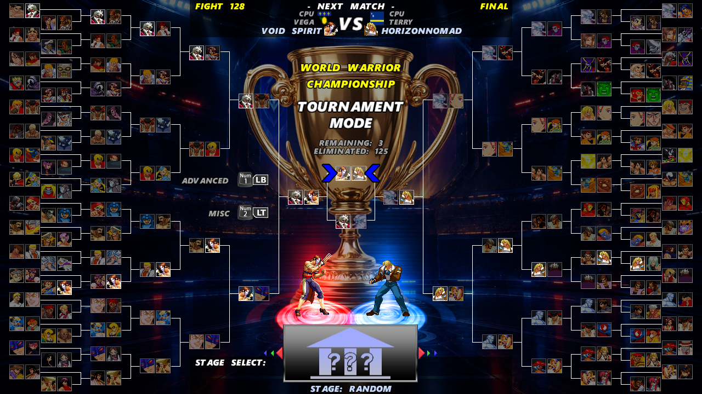

# Tournament-Mode-for-Ikemen-GO

Alright folks, this is a tournament module designed for Ikemen GO.

I’ve set it up to be as simple as possible to install. This means you don't need to change anything in your system.def file, nor do you need to modify your existing character list in select.def. All you have to do is copy the paste into your Ikemen GO external\\mods folder, and that's it.

This module currently supports all resolutions except 320 x 240. I didn't set up the module to work with a 320 x 240 screen because I don't believe anyone plays with a screen that small. On the other hand, you can use a screenpack that employs a 320x240 localcoord. I should point out that localcoord is different from screen resolution; they are distinct things.

I don't think it's necessary to explain the tournament menu functions, as their names are self-explanatory.

Important:

Some screenpacks use custom sprites to render main menu items (Versus, Options, etc.). This means that when Tournament Mode is selected from the main menu, the entire menu may become invisible. There is nothing I can do about this, as it would require me to create a Tournament Mode sprite for every existing screenpack out there. I strongly recommend using screenpacks that render menu items using a font, as the Tournament Mode option will always appear in that case.

Tips:

To reduce loading times in bracket screen, you can add "p1.face.anim = 0" to your system.def screenpack. This adds the animations during the engine's initial loading phase, making the bracket screen load faster. You can do the same with 181 animation, adding "p1.face.done.anim = 181".

Credits:

- Cable Dorado 2 (CD2) for input hints and PlasmoidThunder for SDL key conversion table

- Cable Dorado 2 (CD2) and Orange Dolphin for testing the module

- Devon and OroCrimson for sprites/fonts from Capcom vs SNK Black Edition screenpack

- and Ohmga Shironeko: for allowing me to use some sprites from your screenpack

I hope you enjoy this module! The only thing I ask in return is that you spread the word about it in some way. Feel free to share the module's GitHub link with others and even record YouTube videos showcasing it!

If you have any suggestions, feel free to contact me via Discord: majesticmenace
or trought Ikemen GO official Discord https://discord.gg/m6xnH2suY

