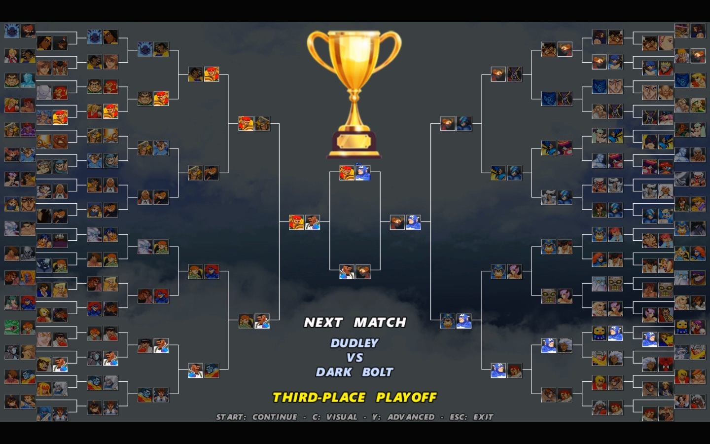

# Tournament-Mode-for-Ikemen-GO

Alright folks, this is a tournament module designed for Ikemen GO.

Tournament Mode has been a dream for many in the MUGEN community — myself included. I had asked for such a module to be created several times, until one day I decided to try making it myself. And I couldn't be happier with the result.

I’ve set it up to be as simple as possible to install. This means you don't need to change anything in your system.def file, nor do you need to modify your existing character list in select.def. All you have to do is copy the paste into your Ikemen GO external\\mods folder, and that's it.

There are five files related to this tournament module:

TournamentMode.lua — the tournament module itself

TournamentMode.sff — sprites

TournamentMode.mp3 — music

TournamentModeFont.def — font definition

TournamentModeFont.sff — font sprites

This module currently supports two screenpack resolutions: 1280 × 720 and 640 × 480.

I focused on these two resolutions because I believe they are the most widely used among the Ikemen GO community. It is important to note that, due to the lack of screen space, the 128-participant option is not available at 640 × 480 resolution.

If there is significant demand for other resolutions, I can create them in the future.

Important

Some screenpacks use custom sprites to render main menu items (Versus, Options, etc.). This means that when Tournament Mode is selected from the main menu, the entire menu may become invisible.

There is nothing I can do about this, as it would require me to create a Tournament Mode sprite for every existing screenpack out there.

I strongly recommend using screenpacks that render menu items using a font, as the Tournament Mode option will always appear in that case.

I don't think it's necessary to explain the tournament menu functions, as their names are self-explanatory.

I hope you enjoy this module! The only thing I ask in return is that you spread the word about it in some way. Feel free to share the module's GitHub link with others and even record YouTube videos showcasing it!

If you have any suggestions, feel free to contact me via Discord: majesticmenace

